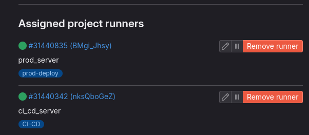

# Secure Pipeline Lab

## High-Level Diagram


## Low-level Diagram

{{ DIAGRAM HERE }}

## Host Pre-requisites
- 4GB of Memory
- 4 CPU cores
- 100GB of storage
- Internet connection
- Git
- Oracle Virtualbox
- Vagrant


## Setup

Clone the repository and change directory to `appsec_demon`

```bash
git clone https://gitlab.com/khazarhajiyev/appsec_demon.git
cd appsec_demon
```

Change directory to `virtual_machines`, copy `.env.sample` to `.env` and fill its content with your favorite text editor

```bash
cd virtual_machines
cp .env.sample .env
```

Run `vagrant up` to set up the virtual machines

```bash
vagrant up
```

To validate your runners successfully registered, go to `appsec_demon` project in your Gitlab account, click `Settings` from left menu, then click `CI/CD` from dropdown menu. In the page opened, look for `Runners` and click `Expand`. You should see a similar result

