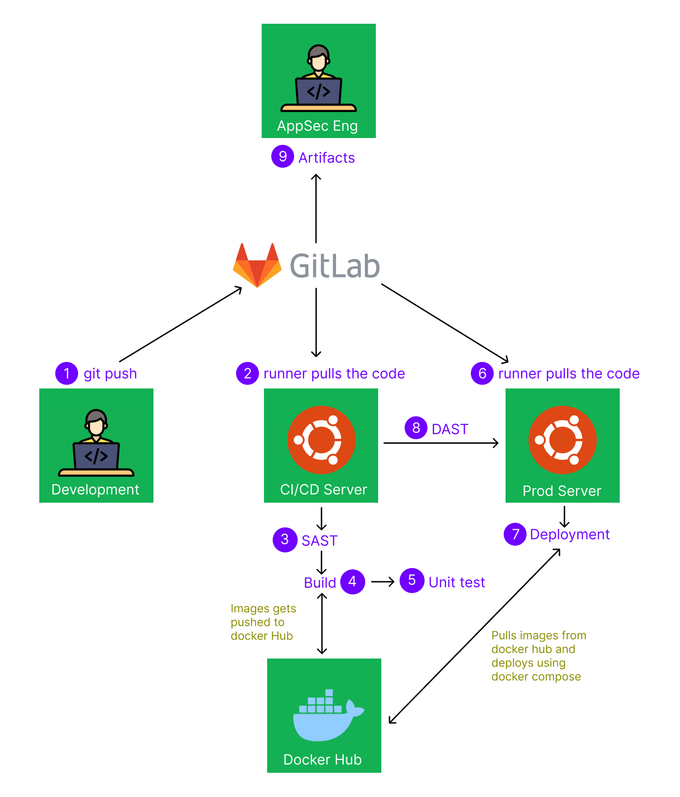
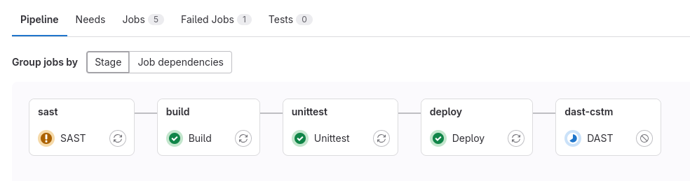

# Secure Pipeline Lab

## High-Level Diagram



## Low-level Diagram

{{ DIAGRAM HERE }}

## Host Pre-requisites
- 4GB of Memory
- 4 CPU cores
- 100GB of storage
- Internet connection
- Git
- Oracle Virtualbox
- Vagrant


## Setup

1. Fork the project

2. Clone the repository and change directory to `appsec_demon`.
Do not forget to change your username in repository URL

```bash
git clone https://gitlab.com/{{YOUR_GITLAB_USERNAME}}/appsec_demon.git
cd appsec_demon
```

3. Change directory to `virtual_machines`, copy `env.sample` to `.env` and fill its content with your favorite text editor

```bash
cd virtual_machines
cp env.sample .env
```

The information you will need to fill in:
- PROJECT_ID - you can get project id by navigating `settings` and then clicking `general` tab from the dropdown menu
- GITLAB_ACCESS_TOKEN - offical guide explains better: [Create Personal Access Token](https://docs.gitlab.com/ee/tutorials/automate_runner_creation/?tab=Project#create-a-personal-access-token)
- NIC - network interface name with internet access 
- CI_CD_SERVER_IP - any empty address in your subnet
- PROD_SERVER_IP - any empty address in your subnet


4. Run `vagrant up` to set up the virtual machines

```bash
vagrant up
```

5. To validate your runners successfully registered, go to `appsec_demon` project in your Gitlab account, click `Settings` from left menu, then click `CI/CD` from dropdown menu. In the page opened, look for `Runners` and click `Expand`. You should see a similar result


6. Switch to `dev` branch, add a space to `update_file` and merge it to `prod` branch to trigger deployment 

```bash
cd ..
git checkout dev
echo " " >> update_file
git add update_file
git commit -m "adding a space to update_file"
git push origin dev
git checkout prod
git merge dev
git push origin prod
```

7. Navigate `Pipeline` under `Build` section from left menu in repository to check if deployment is started. You should see similar result




8. Navigate using prod server's IP in browser to see if application is deployed and accessible (check .env file if you forgot the IP)

