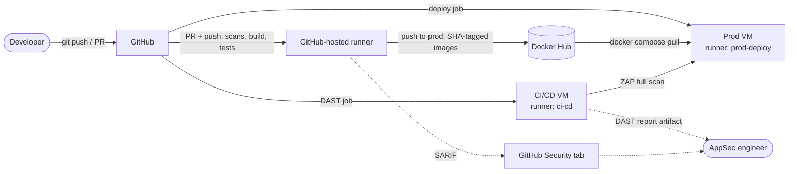
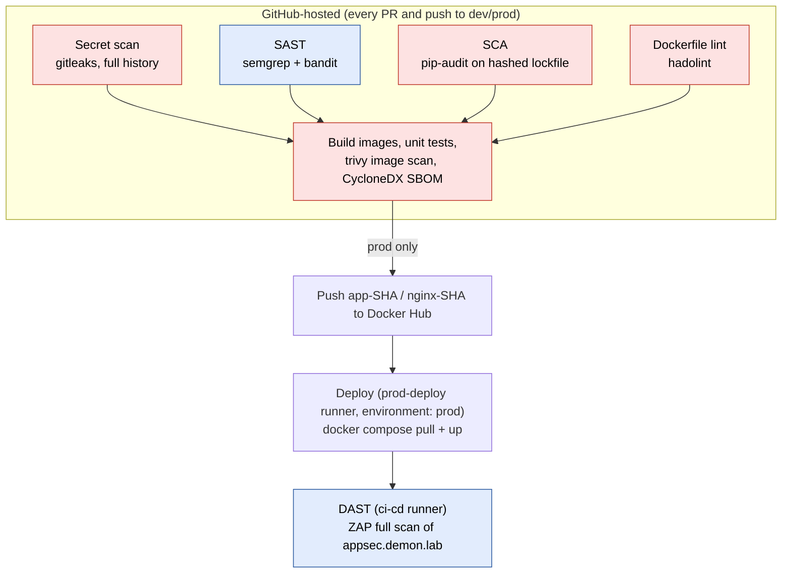
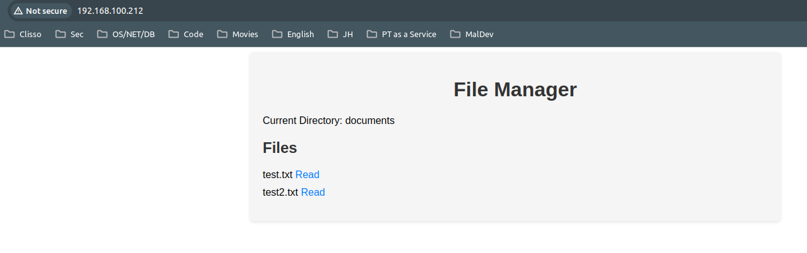

# AppSec Demon - Secure Pipeline Lab

A hands-on lab for building a secure CI/CD pipeline with GitHub Actions, two self-hosted runners in local VMs, and an **intentionally vulnerable** Flask file manager as the target.

> [!WARNING]
> `myprj/app.py` contains deliberate vulnerabilities (path traversal, XSS) for the scanners to find. Never expose the prod VM to the internet.

## High-Level Diagram



## Low-Level Diagram



Red jobs **fail the pipeline**. Blue jobs are **report-only**, because the app is vulnerable on purpose; their results land in the Security tab (SAST) and in a downloadable artifact (DAST).

| Control | Tool | Blocks? |
|---|---|---|
| Secret scanning | gitleaks (full git history) | Yes |
| SAST | Semgrep (`p/python`, `p/flask`), Bandit → Security tab | No (report) |
| SCA / dependency check | pip-audit against `requirements.txt` (hash-pinned) | Yes |
| Dockerfile lint | hadolint (warning and above) | Yes |
| Container scanning | Trivy, fixable HIGH/CRITICAL | Yes |
| SBOM | Trivy CycloneDX, uploaded as `sbom` artifact | n/a |
| DAST | OWASP ZAP full scan, uploaded as `dast-report` artifact | No (report) |
| Version pinning | Base images and tool images by digest, Actions by commit SHA, Python deps by hash; Dependabot keeps pip, Dockerfiles and Actions current | n/a |

## Requirements
- A will to learn :)
- 4GB of Memory
- 4 CPU cores
- 80GB of storage
- Internet connection
- Git
- Oracle VirtualBox
- Vagrant, plus the `vagrant-env` plugin (`vagrant plugin install vagrant-env`)
- GitHub account
- Docker Hub account

## Setup

### 1. Fork and clone

Fork the repository. **Untick "Copy the `dev` branch only"**, because the pipeline deploys from the `prod` branch. Then clone your fork:

```bash
git clone https://github.com/<YOUR_GITHUB_USERNAME>/appsec-demon.git
cd appsec-demon
```

### 2. Lock down Actions on your fork

The self-hosted runners execute jobs directly on your VMs. On a public repository, anyone can open a pull request that edits the workflow, so require approval before outside code runs:

**Settings → Actions → General → Approval for running fork pull request workflows from contributors → "Require approval for all external contributors"**

> 📸 _Screenshot to add: `images/ACTIONS_GENERAL.png` (this setting selected)_

### 3. Add Docker Hub credentials

Create a Docker Hub repository and an access token (`https://app.docker.com/settings/personal-access-tokens`, Read & Write). Then go to **Settings → Secrets and variables → Actions**:

- **Secrets** tab → `DOCKER_HUB_ACCESS_TOKEN`: the access token
- **Variables** tab → `DOCKER_HUB_USERNAME`: your Docker Hub username
- **Variables** tab → `DOCKER_HUB_REPOSITORY`: the repository name

> 📸 _Screenshot to add: `images/SECRETS.png` (Actions secrets and variables page)_

### 4. Create the `prod` environment

**Settings → Environments → New environment → `prod`**. Under *Deployment branches and tags*, choose **Selected branches** and add `prod`. Optionally add yourself as a **Required reviewer** so every deploy waits for your approval.

> 📸 _Screenshot to add: `images/ENVIRONMENT.png` (prod environment rules)_

### 5. (Recommended) Protect the `prod` branch

**Settings → Rules → Rulesets → New branch ruleset**, target `prod`, enable **Require a pull request before merging** and **Require status checks to pass** (select the `Secret scan`, `Dependency scan`, `Dockerfile lint` and `Build, test, scan images` checks after their first run).

### 6. Configure and start the VMs

Copy `env.sample` to `.env` and fill it in:

```bash
cd virtual_machines
cp env.sample .env
```

- **GITHUB_REPOSITORY**: your fork as `owner/appsec-demon`
- **GITHUB_TOKEN**: a [fine-grained personal access token](https://github.com/settings/personal-access-tokens/new) scoped to *only* your fork, with **Repository permissions → Administration: Read and write**. It is only used to get runner registration tokens; revoke it once both runners show up.
- **CI_CD_SERVER_IP** / **PROD_SERVER_IP**: two free addresses in your subnet
- **NIC**: host network interface with internet access

```bash
vagrant up
```

> [!NOTE]
> If you already have VirtualBox VMs named `ci_cd_server` or `prod_server`, rename them in `virtual_machines/Vagrantfile` first.

### 7. Check the runners

**Settings → Actions → Runners** should list `ci-cd-server` (label `ci-cd`) and `prod-server` (label `prod-deploy`) as **Idle**.

> 📸 _Screenshot to add: `images/RUNNERS.png` (both runners Idle)_

### 8. Trigger a deployment

Open a pull request from `dev` to `prod`. The scan jobs run on the PR. Merge it to run the full pipeline including build, deploy and DAST:

```bash
gh pr create --base prod --head dev --title "Deploy" --body "Trigger pipeline"
gh pr merge --merge
```

Or run it by hand: **Actions → pipeline → Run workflow → Branch: prod**.

### 9. Watch the pipeline

**Actions → pipeline** shows each job. If you set a required reviewer on `prod`, approve the deployment when prompted.

> 📸 _Screenshot to add: `images/PIPELINE.png` (a successful prod run, all jobs)_

Code findings appear under **Security → Code scanning**. The ZAP report and SBOMs are under **Artifacts** at the bottom of the run summary.

> 📸 _Screenshot to add: `images/CODE_SCANNING.png` (Semgrep/Bandit alerts)_

### 10. Open the application

Browse to the prod server's IP (see `virtual_machines/.env`):



## Updating pinned versions

Dependabot opens weekly PRs for Python packages, Dockerfile base images and GitHub Actions. The scanner images in `.github/workflows/pipeline.yml` (`env:` block) and the runner version in the `Vagrantfile` are pinned by hand; update the tag **and** digest/checksum together.

To change Python dependencies, edit `myprj/requirements.in` and regenerate the lockfile:

```bash
cd myprj
uv pip compile requirements.in --python-version 3.13 --generate-hashes --upgrade -o requirements.txt
```
